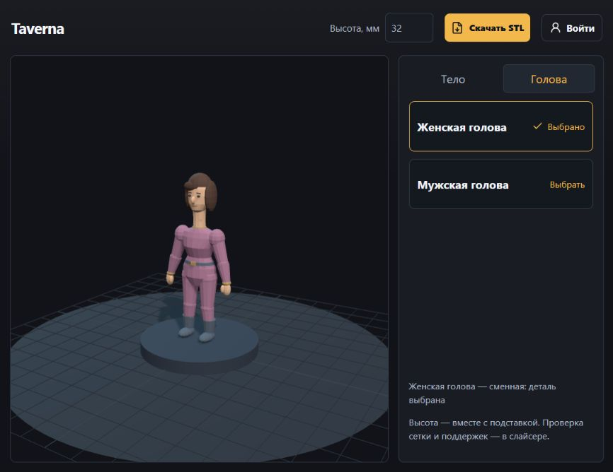
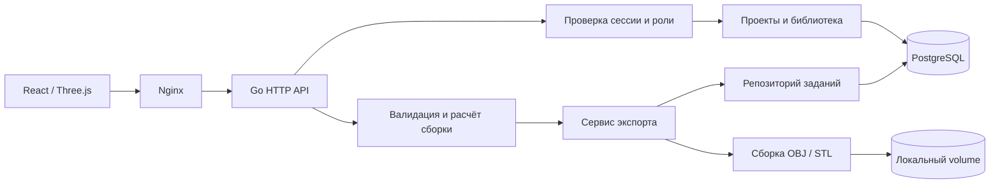

# Устройство Taverna

Приложение собирает персонажа из загруженных 3D-моделей. Гость может скачать STL; аккаунт нужен для сохранения проектов, роль администратора — для изменения общей библиотеки.



## Запрос и экспорт



HTTP-обработчики проверяют запрос и доступ. Сервисы каталога и сборки проверяют совместимость и рассчитывают преобразования. Сервис экспорта управляет созданием задания, генерацией файла, завершением и обработкой ошибок. Репозитории выполняют SQL. Гостевой STL строится без записи проекта и задания в БД.

Экспорт выполняется синхронно с ограничением времени. Поддерживаются файлы OBJ и STL; неподдерживаемый формат отклоняется. Ошибка детали прерывает весь файловый экспорт и удаляет неполный файл. Задание получает `failed`; готовый файл — `completed`. Сбой записи конечного статуса тоже возвращается как ошибка. При недоступной БД или аварийном завершении процесса запись может остаться `processing`: отдельного фонового восстановления заданий пока нет.

## Хранение и согласованность

| Таблица | Назначение и связи |
| --- | --- |
| `users` | Пользователь, нормализованный уникальный email, роль, хеш пароля |
| `user_sessions` | Хеш токена сессии; внешний ключ на пользователя |
| `user_email_tokens` | Одноразовые токены подтверждения и восстановления |
| `projects` | Владелец и версионированная конфигурация JSONB |
| `model_assets` | Метаданные модели; исходный файл находится в volume |
| `model_asset_anchors` | Локальные точки крепления; составной ключ модели и точки |
| `project_asset_references` | Ссылки проекта на модели и точки крепления |
| `export_jobs` | Состояние и результат экспорта; внешний ключ на проект |

JSONB удобен для конфигурации персонажа. Триггеры в той же транзакции синхронизируют её ссылки с реляционными таблицами. Внешние ключи запрещают удалять используемые модели и точки крепления, включая конкурентное сохранение проекта. Миграции сериализованы advisory lock на отдельном соединении.

Исходные модели и результаты экспорта хранятся в локальных volumes. База и файлы не образуют общую транзакцию: обычные ошибки компенсируются удалением созданного файла, а авария процесса может оставить лишний файл. Удаление проекта удаляет строки заданий, но автоматическая сборка оставшихся файлов не реализована.

## Границы и проверки

- Пароли хешируются Argon2id. В БД находятся хеши токенов сессий и почтовых ссылок. Проверка владельца проекта входит в SQL.
- JSON ограничен по размеру; лишние значения и неизвестные поля запроса отклоняются. Списки используют `limit`, `offset` и `X-Next-Offset`.
- Одновременно обрабатываются до двух загрузок/экспортов на экземпляр backend. Парсеры ограничивают геометрию и распакованный объём 3MF; длительные операции поддерживают отмену.
- STL сохраняет геометрию. Замкнутость сетки, объединение оболочек и поддержка печати не гарантируются.
- API описан в [openapi.json](openapi.json). Развёртывание — в корневом README.

Проверка backend из каталога `backend`:

```sh
go test ./...
go vet ./...
go test -race ./...
go run golang.org/x/vuln/cmd/govulncheck@v1.9.0 ./...
```

Для интеграционных тестов задайте `TEST_DATABASE_URL` на PostgreSQL 16. Тесты создают отдельные схемы и удаляют их после выполнения. Они проверяют аккаунты, изоляцию проектов, ошибки экспорта, обновление миграций и конкуренцию сохранения/удаления. CI также собирает контейнеры и проверяет запуск на пустой базе, загрузку стартовых моделей и восемь STL-экспортов.
